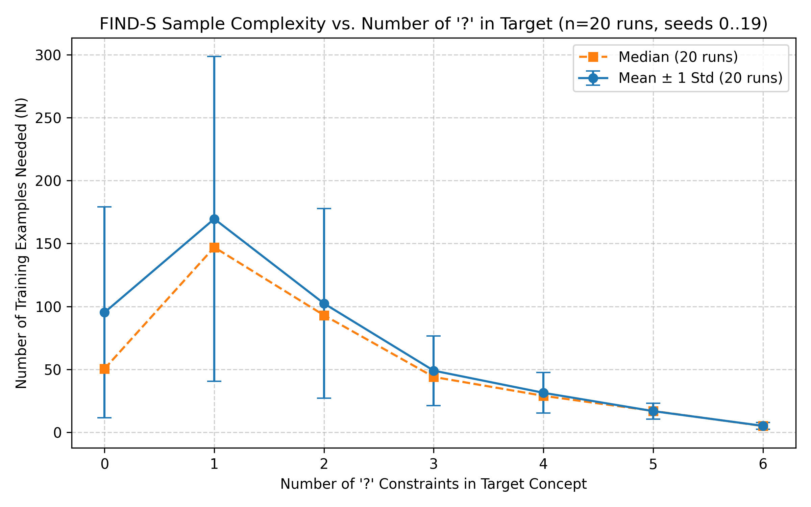

# Concept Learning: Find-S on EnjoySport

Homework 1 of the Machine Learning course, based on Chapter 2 of *Machine Learning* by Tom M. Mitchell.

This project implements the **Find-S** algorithm from scratch (no machine-learning libraries) on the **EnjoySport** problem, and runs a reproducible experiment that measures how many random training examples Find-S needs to learn a target concept exactly.

Part of the course repository: [Machine-Learning-Fall-2026-SBUK](../README.md).

## Table of contents

- [Overview](#overview)
- [Background](#background)
- [Repository structure](#repository-structure)
- [Getting started](#getting-started)
- [How it works](#how-it-works)
- [Experiment design](#experiment-design)
- [Results](#results)
- [Theory summary](#theory-summary)
- [Reproducibility](#reproducibility)
- [Troubleshooting](#troubleshooting)
- [Limitations](#limitations)
- [References](#references)
- [Author](#author)

## Overview

`run_all.py` is a single script that runs three parts in order:

1. **Find-S trace on Table 2.1.** Prints the step-by-step trace and reproduces the trace in Section 2.4 of the textbook.
2. **Main experiment (Exercise 2.10).** Generates random instances, labels them with the target concept `<Sunny, Warm, ?, ?, ?, ?>`, and runs Find-S until it outputs exactly the target or reaches `N_max = 1000` examples. This is repeated for 20 independent runs (seeds `0..19`).
3. **Effect of the number of `?` constraints.** Repeats the experiment for seven targets with 0 to 6 `?` constraints, prints a summary table, and saves a plot.

## Background

### The EnjoySport task

Each instance describes a day with six attributes. The label says whether the person enjoys their sport that day.

| Attribute | Possible values |
|-----------|-----------------|
| Sky | Sunny, Cloudy, Rainy |
| AirTemp | Warm, Cold |
| Humidity | Normal, High |
| Wind | Strong, Weak |
| Water | Warm, Cool |
| Forecast | Same, Change |

The instance space has |X| = 3 · 2⁵ = **96** instances.

Training examples (Table 2.1 of the textbook):

| # | Sky | AirTemp | Humidity | Wind | Water | Forecast | EnjoySport |
|--:|-----|---------|----------|------|-------|----------|------------|
| 1 | Sunny | Warm | Normal | Strong | Warm | Same | Yes |
| 2 | Sunny | Warm | High | Strong | Warm | Same | Yes |
| 3 | Rainy | Cold | High | Strong | Warm | Change | No |
| 4 | Sunny | Warm | High | Strong | Cool | Change | Yes |

### Hypothesis representation

A hypothesis is a conjunction of six constraints, one per attribute. Each constraint is one of:

- a specific value (for example `Sunny`): the attribute must have exactly this value,
- `?`: any value is acceptable,
- `∅`: no value is acceptable.

A hypothesis that contains `∅` rejects every instance. For example, `<Sunny, Warm, ?, ?, ?, ?>` says "I enjoy my sport on every sunny, warm day".

### The Find-S algorithm

Find-S starts with the most specific hypothesis and generalizes it minimally every time a positive example is not covered. Negative examples are ignored.

```
h ← <∅, ∅, ∅, ∅, ∅, ∅>
for each training example (x, c(x)):
    if c(x) = Yes:
        for each attribute i:
            if h[i] = ∅:                      h[i] ← x[i]
            else if h[i] ≠ ? and h[i] ≠ x[i]: h[i] ← ?
return h
```

## Repository structure

This homework lives in its own folder inside the course repository:

```
Machine-Learning-Fall-2026-SBUK/
└── ml-hw01-concept-learning/
    ├── run_all.py                 # all code: hypothesis representation, Find-S, experiments, plot
    ├── output.txt                 # sample console output of run_all.py
    ├── exercise_2_10_plot.png     # figure generated by run_all.py
    ├── requirements.txt           # numpy, matplotlib
    └── README.md                  # this file
```

## Getting started

**Requirements:** Python 3.8 or newer, plus the two packages in `requirements.txt`.

```bash
# 1. clone the course repository and enter this homework's folder
git clone https://github.com/mohammad1i/Machine-Learning-Fall-2026-SBUK.git
cd Machine-Learning-Fall-2026-SBUK/ml-hw01-concept-learning

# 2. (optional) create a virtual environment
python -m venv .venv
# Windows:
.venv\Scripts\activate
# macOS / Linux:
source .venv/bin/activate

# 3. install dependencies
pip install -r requirements.txt

# 4. run everything
python run_all.py
```

On some systems the command is `python3` and `pip3` instead of `python` and `pip`.

The script prints everything to the console and saves `exercise_2_10_plot.png` in the same folder as `run_all.py`, regardless of the folder you run it from. At the end a plot window opens. Close it to let the script finish.

To save the console output to a file, use **Command Prompt** (or any Linux/macOS shell):

```bash
python run_all.py > output.txt
```

### Example output (first lines)

```
======================================================================
Part 1: FIND-S Trace on Table 2.1 (EnjoySport)
======================================================================
h_0 = <∅, ∅, ∅, ∅, ∅, ∅>
Example 1 (+): <Sunny, Warm, Normal, Strong, Warm, Same>
h_1 = <Sunny, Warm, Normal, Strong, Warm, Same>
Example 2 (+): <Sunny, Warm, High, Strong, Warm, Same>
h_2 = <Sunny, Warm, ?, Strong, Warm, Same>
Example 3 (-): <Rainy, Cold, High, Strong, Warm, Change>
h_3 = <Sunny, Warm, ?, Strong, Warm, Same>
Example 4 (+): <Sunny, Warm, High, Strong, Cool, Change>
h_4 = <Sunny, Warm, ?, Strong, ?, ?>
```

The complete output is in [`output.txt`](output.txt).

## How it works

| Function | Purpose |
|----------|---------|
| `satisfies(h, x)` | Returns `True` if instance `x` is classified positive by hypothesis `h`. Any hypothesis containing `∅` rejects every instance. |
| `is_more_general_or_equal(h_j, h_k)` | The "more general than or equal to" test (`h_j ≥_g h_k`). A hypothesis with `∅` is more specific than everything, so the `∅` cases are checked first. Otherwise every constraint of `h_j` must be `?` or equal to the constraint of `h_k`. |
| `is_strictly_more_general(h_j, h_k)` | `h_j >_g h_k`: `h_j ≥_g h_k` holds and `h_k ≥_g h_j` does not. |
| `init_most_specific_hypothesis()` | Returns `<∅, ∅, ∅, ∅, ∅, ∅>`. |
| `find_s_step(h, x, label)` | One Find-S update. Negative examples return `h` unchanged. |
| `run_find_s_on_table_2_1()` | Runs Find-S on Table 2.1 and prints the trace. |
| `generate_random_instance(rng)` | Samples one instance uniformly from the 96 possible instances. |
| `label_instance(x, target)` | Labels `x` as `Yes` or `No` according to the target concept. |
| `run_single_experiment(target, seed, n_max)` | One run with the two stopping conditions. Returns the number of examples, the number of positive examples and the stopping condition. |
| `compute_statistics(values)` | Mean, sample standard deviation, median, IQR, minimum and maximum. |
| `run_exercise_2_10_experiments(seeds, n_max)` | Runs the main experiment and the `?`-count study, prints the tables and saves the plot. |

Instances and hypotheses are immutable 6-tuples of strings, so they can be compared directly with `==`.

Only NumPy (random numbers and statistics) and Matplotlib (plot) are used. The hypothesis representation, the generality test, Find-S and the instance generator are written from scratch.

## Experiment design

- **Target concept.** Main experiment: `<Sunny, Warm, ?, ?, ?, ?>`. Second study: seven targets with 0 to 6 `?` constraints (the first constraints stay specific, the last ones become `?`).
- **Training data.** Instances are drawn uniformly at random from the 96 possible instances and labelled by the target concept. Duplicates are possible, because sampling is with replacement.
- **Stopping criterion.** Each run stops as soon as one of these happens first:
  1. Find-S outputs exactly the target concept, or
  2. `N_max = 1000` training examples have been used.

  Runs that end by condition (ii) would be reported separately and not included in the mean. No run ended by condition (ii).
- **Seeds.** 20 independent runs with seeds `0, 1, ..., 19`. Every run has its own generator, `np.random.default_rng(seed)`. The same 20 seeds are used for every target.
- **Statistics.** Mean, sample standard deviation (`ddof=1`), median, interquartile range (75th minus 25th percentile, NumPy's default linear interpolation), minimum and maximum of the number of training examples.

## Results

### Find-S trace on Table 2.1

Find-S outputs `<Sunny, Warm, ?, Strong, ?, ?>`, which matches Section 2.4 of the textbook.

### Main experiment: target `<Sunny, Warm, ?, ?, ?, ?>`

All 20 runs ended by condition (i). None reached `N_max`.

| Statistic | Number of training examples |
|-----------|-----------------------------|
| Mean ± Std | 31.40 ± 16.11 |
| Median (IQR) | 29.00 (15.25) |
| Min / Max | 8 / 83 |

The raw result of each run (seed, number of examples, number of positive examples, stopping condition) is in [`output.txt`](output.txt).

### Effect of the number of `?` constraints

20 runs per target, seeds `0..19`. All runs ended by condition (i). `P(positive)` is the probability that a uniformly random instance satisfies the target.

| # of `?` | Target | P(positive) | Mean ± Std | Median (IQR) | Min / Max |
|---------:|--------|------------:|-----------|--------------|-----------|
| 0 | `<Sunny, Warm, Normal, Strong, Warm, Same>` | 1/96 | 95.25 ± 83.80 | 50.5 (100.5) | 7 / 273 |
| 1 | `<Sunny, Warm, Normal, Strong, Warm, ?>` | 1/48 | 169.55 ± 129.01 | 147.0 (143.0) | 43 / 507 |
| 2 | `<Sunny, Warm, Normal, Strong, ?, ?>` | 1/24 | 102.35 ± 75.32 | 93.0 (59.8) | 15 / 271 |
| 3 | `<Sunny, Warm, Normal, ?, ?, ?>` | 1/12 | 49.00 ± 27.64 | 44.0 (37.8) | 7 / 103 |
| 4 | `<Sunny, Warm, ?, ?, ?, ?>` | 1/6 | 31.40 ± 16.11 | 29.0 (15.2) | 8 / 83 |
| 5 | `<Sunny, ?, ?, ?, ?, ?>` | 1/3 | 16.85 ± 6.23 | 17.0 (4.5) | 6 / 30 |
| 6 | `<?, ?, ?, ?, ?, ?>` | 1 | 5.15 ± 2.72 | 5.0 (2.0) | 2 / 15 |



*Figure: number of training examples Find-S needs, as a function of the number of `?` constraints in the target (20 runs per point; blue: mean ± 1 standard deviation, orange dashed: median).*

### Interpretation

Find-S only learns from positive examples, so the number of examples is roughly

> (number of positive examples needed) ÷ P(positive).

- **More `?` constraints make positive examples more common.** Each extra `?` doubles P(positive) (and for the last step, where `Sky` becomes `?`, it triples it). From 1 to 6 `?` constraints, the mean number of examples falls steadily from about 170 to about 5.
- **Positive examples must show both values of every `?` attribute.** A `?` constraint is only reached after Find-S has seen a positive example with each of two different values for that attribute, so a few more positive examples are needed, but this grows slowly compared with the speed at which P(positive) grows.
- **The fully specified target (0 `?`).** One positive example is already enough to give exactly the target, but only 1 in 96 random instances is positive. This is why this case needs about 95 examples on average, with a very large spread (standard deviation about 84).

## Theory summary

These parts of the homework were solved by hand. They are not implemented in `run_all.py`.

### Exercise 2.1: sizes of the spaces

| Quantity | Computation | Size |
|----------|-------------|-----:|
| Instances | 3 · 2⁵ | 96 |
| Syntactically distinct hypotheses | 5 · 4⁵ (each attribute: its values + `?` + `∅`) | 5120 |
| Semantically distinct hypotheses | 1 + 4 · 3⁵ (all hypotheses with `∅` mean the same: reject everything) | 973 |

Adding the attribute `WaterCurrent` with 3 values (Light, Moderate, Strong) gives 288 instances, 25,600 syntactically distinct hypotheses and 3,889 semantically distinct hypotheses.

For a new attribute with `k` values: instances grow by a factor `k`, syntactically distinct hypotheses by a factor `k + 2`, and semantically distinct hypotheses become `1 + (k + 1)(|H_sem| − 1)`.

### Exercise 2.2: Candidate-Elimination, examples in the order 4 → 3 → 2 → 1

```
S0 = {<∅, ∅, ∅, ∅, ∅, ∅>}
G0 = {<?, ?, ?, ?, ?, ?>}

After example 4 (+):
S1 = {<Sunny, Warm, High, Strong, Cool, Change>}
G1 = {<?, ?, ?, ?, ?, ?>}

After example 3 (-):
S2 = {<Sunny, Warm, High, Strong, Cool, Change>}
G2 = {<Sunny, ?, ?, ?, ?, ?>, <?, Warm, ?, ?, ?, ?>, <?, ?, ?, ?, Cool, ?>}

After example 2 (+):
S3 = {<Sunny, Warm, High, Strong, ?, ?>}
G3 = {<Sunny, ?, ?, ?, ?, ?>, <?, Warm, ?, ?, ?, ?>}

After example 1 (+):
S4 = {<Sunny, Warm, ?, Strong, ?, ?>}
G4 = {<Sunny, ?, ?, ?, ?, ?>, <?, Warm, ?, ?, ?, ?>}
```

The final S4 and G4 are identical to Figure 2.7 of the textbook, which uses the order 1 → 2 → 3 → 4. The final version space does not depend on the order of the examples, because it is defined as the set of hypotheses consistent with all examples. Only the intermediate boundaries depend on the order.

### Key takeaways

- On Table 2.1, the Find-S output equals the S boundary of the version space. This holds when the target is in the hypothesis space and the data has no label noise.
- Ignoring negative examples is safe under those two assumptions, because the target is always at least as general as the current Find-S hypothesis.
- Find-S keeps only one hypothesis, so it cannot detect a mislabelled example or tell how many hypotheses are still consistent. Candidate-Elimination keeps the whole version space, and it becomes empty if the data is inconsistent or the target is not in the hypothesis space.

## Reproducibility

- All randomness comes from `np.random.default_rng(seed)` with the recorded seeds `0..19`, one generator per run.
- Running `python run_all.py` again gives the same numbers as in this README and in `output.txt`.
- NumPy does not guarantee that the random stream of `default_rng` stays identical across major versions. If you ever get slightly different numbers on a very different NumPy version, the algorithm is not at fault. Run `pip list` to see which versions you have.

## Troubleshooting

| Problem | Solution |
|---------|----------|
| `ModuleNotFoundError: No module named 'numpy'` (or `matplotlib`) | Run `pip install -r requirements.txt`. Make sure your virtual environment is activated if you use one. |
| The script seems stuck at the end | A plot window is open. Close it and the script finishes. |
| No display available (server, remote shell) | Set the non-interactive backend: `MPLBACKEND=Agg python run_all.py` on Linux/macOS, or `set MPLBACKEND=Agg` and then `python run_all.py` in Windows Command Prompt. The plot file is still saved. |
| `∅` shows as `?` or garbled characters in `output.txt` | Use Command Prompt (not PowerShell) for `python run_all.py > output.txt`. PowerShell can change the file encoding when redirecting. The script already switches the console to UTF-8 where possible. |
| `python` is not recognized | Use `py` (Windows) or `python3` (Linux/macOS), or install Python from python.org and tick "Add Python to PATH". |

## Limitations

- The hypothesis space is conjunctions of attribute constraints only. Disjunctive concepts (for example `Sky = Sunny OR Sky = Cloudy`) cannot be represented.
- Find-S assumes noise-free data and a target concept inside the hypothesis space. With noisy labels or a target outside `H`, its output is unreliable and it cannot tell.
- Candidate-Elimination is only traced by hand in this project. It is not implemented in `run_all.py`.
- Each experiment uses 20 runs, so the standard deviations and IQRs are estimates with considerable uncertainty, especially for targets with few `?` constraints.

## References

- T. M. Mitchell, *Machine Learning*, McGraw-Hill, 1997. Chapter 2: Concept Learning and the General-to-Specific Ordering.

## Author

GitHub: [@mohammad1i](https://github.com/mohammad1i)

*This repository is a student homework solution, shared for reference. If you are taking this course, please write your own solution.*
